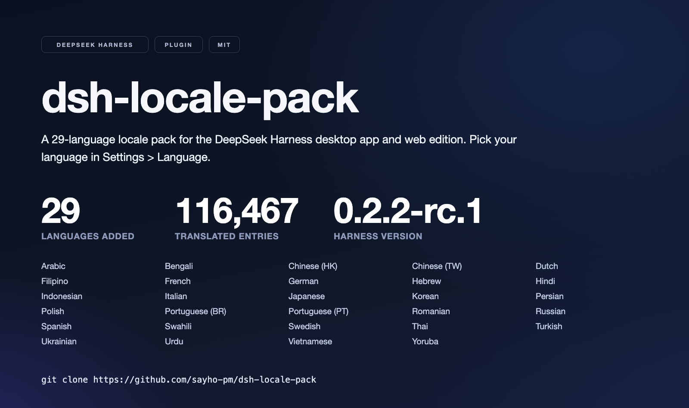

# dsh-locale-pack

<p align="right"><strong>English</strong> | <a href="README.ko.md">한국어</a> | <a href="README.zh-TW.md">繁體中文</a> | <a href="README.id.md">Bahasa Indonesia</a> | <a href="README.vi.md">Tiếng Việt</a> | <a href="README.tr.md">Türkçe</a></p>

<p align="center"></p>

Paket lokal untuk DeepSeek Harness, yang mencakup aplikasi desktop dan edisi browser. Paket ini mendaftarkan 23 kamus di pemilih bahasa, satu untuk setiap bahasa yang belum disediakan DeepSeek Harness. String yang belum diterjemahkan akan kembali ke bahasa Inggris, sehingga tampilan tetap terbaca selagi cakupan bertambah. Bersama bahasa Inggris dan Mandarin Sederhana bawaan, ada 25 bahasa yang dapat dipilih setelah pemasangan. Paket ini selalu diperbarui agar sesuai dengan rilis DeepSeek Harness terbaru. Paket ini juga terdaftar di [awesome-deepseek-harness](https://github.com/0xsline/awesome-deepseek-harness), indeks komunitas plug-in dan alat DSH.

## Mengapa ini ada

DeepSeek Harness adalah alat coding: Anda memberinya tugas dan agen membaca file, mengeditnya, dan menjalankan perintah terminal. Antarmuka desktopnya dibangun di sekitar obrolan, pengaturan, manajemen plugin, subagen, riwayat tugas, prompt persetujuan, masukan suara, dan pekerjaan terjadwal.

Antarmuka itu tersedia dalam bahasa Inggris dan bahasa Tionghoa Sederhana. Pengembang yang lebih memilih bekerja dalam bahasa lain harus membaca setiap label dalam bahasa kedua. Proyek ini mengisi kesenjangan itu dengan menambahkan kamus, dan dengan menjaga jumlah bahasa tetap luas alih-alih mendalam: suatu bahasa dapat digunakan begitu pemilih menyediakannya dan layar-layar umum dapat dibaca.

DeepSeek Harness awalnya hanya menyertakan bahasa Inggris dan Mandarin Sederhana, dan pada 0.2.2-rc.1 sudah menyertakan delapan bahasa. Jika nanti ia menyertakan bahasa Korea, Turki, Vietnam, Indonesia, atau bahasa lain yang dicakup paket ini, paket ini akan memperlambat atau menghentikan pembaruan bahasa tersebut alih-alih memelihara salinan kedua.

## Bahasa yang didukung

| Language | Code | Language | Code |
|---|---|---|---|
| 한국어 | `ko` | Polski | `pl` |
| 繁體中文 (台灣) | `zh-tw` | Українська | `uk` |
| 繁體中文 (香港) | `zh-hk` | Svenska | `sv` |
| Türkçe | `tr` | Bahasa Indonesia | `id` |
| Tiếng Việt | `vi` | Português (Brasil) | `pt-br` |
| ไทย | `th` | Italiano | `it` |
| हिन्दी | `hi` | Nederlands | `nl` |
| العربية | `ar` | Filipino | `tl` |
| Română | `ro` | বাংলা | `bn` |
| اردو | `ur` | עברית | `he` |
| فارسی | `fa` | Kiswahili | `sw` |
| Yorùbá | `yo` |  |  |

23 bahasa, 4,491 kunci masing-masing — 103,296 entri terjemahan secara keseluruhan. Kamus diperbarui setiap kali DeepSeek Harness merilis versi baru; saat ini mengikuti `0.2.2-rc.3`.

## Instal

Aplikasi desktop DeepSeek Harness harus diinstal terlebih dahulu. Kemudian klon repositori dan daftarkan sebagai tautan plugin.

macOS dan Linux (bash):

```bash
# 1) Get the sources
git clone https://github.com/sayho-pm/dsh-locale-pack.git
cd dsh-locale-pack

# 2) Register the folder with the desktop profile
dsh plugin --profile desktop add link:$(pwd)
```

Windows (PowerShell):

```powershell
# 1) Get the sources
git clone https://github.com/sayho-pm/dsh-locale-pack.git
cd dsh-locale-pack

# 2) Register the folder with the desktop profile
dsh plugin --profile desktop add link:(Get-Location).Path
```

Kemudian buka **Pengaturan → Bahasa** dan pilih bahasa yang Anda inginkan.

### Daftar di edisi web

Edisi browser (profil `web`) mendaftar dengan cara yang sama. Hanya nama profil yang berubah.

```bash
# register in the web profile, then start the server
dsh plugin --profile web add link:$(pwd)
dsh web
```

Buka alamat yang dicetak oleh `dsh web`, lalu pilih bahasa di bawah **Pengaturan → Bahasa**. Profil web dibuat secara otomatis pada pendaftaran pertama.

### Instal dengan asisten AI

Jika Anda tidak memiliki lingkungan pengembangan, asisten AI dapat melakukan penyiapan untuk Anda. Buka asisten dan tempelkan ini:

```
Install this GitHub repository: https://github.com/sayho-pm/dsh-locale-pack
Wherever I have to type something myself, such as a token or a path,
mark it with **** and tell me exactly where it goes. Handle the rest.
```

Asisten menjalankan perintah dan berhenti hanya pada titik yang membutuhkan masukan Anda.

## Tata letak repositori

```text
locale/<language>/*.json   Dictionary sources — edit here
locale/<language>.json     Plugin display text per language (title/description)
locale/_policy/            Terms kept in English
lib/client.js              Generated bundle (from the dictionaries)
styles/locale-fonts.css    Locale-scoped font corrections (inlined at build)
tools/build-client.mjs     Dictionaries → lib/client.js
tools/smoke.mjs            Smoke test
tools/check-keep.mjs       Translation quality check
tools/translate_worker.py  Translation worker (runs outside the chat session)
tools/clean-romanized.py   Fixes transliteration slips
tools/en.baseline.json     English baseline (DeepSeek Harness 0.2.2-rc.3)
```

## Mengedit string

```bash
node tools/build-client.mjs   # rebuild lib/client.js
node tools/smoke.mjs          # self-check: loading, fallback, idempotence
node tools/check-keep.mjs     # translation quality check
```

Placeholders such as `{name}` must be kept exactly as they are. If the order or the spelling changes, the sentence breaks at runtime.

### Membundel hanya bahasa yang Anda butuhkan

Menginstal seluruh paket adalah bawaan, dan mengganti bahasa setelahnya cukup melalui layar pengaturan. Jika bundel lengkap lebih dari yang Anda inginkan, buat subset saja:

```bash
node tools/build-client.mjs --langs ko,ja   # Korean and Japanese only
```

Bundel dua bahasa berukuran sekitar 575 KB, bukan 8.3 MB. Flag tersebut menerima daftar kode bahasa apa pun yang dipisahkan koma pada tabel di atas. Menghilangkannya akan membangun ulang setiap bahasa.

## Catatan untuk pengguna

- Bahasa Arab, Urdu, Ibrani, dan Persia ditulis dari kanan ke kiri. Kamusnya sudah siap; tata letak layar ditangani oleh DeepSeek Harness itu sendiri.
- Bilah menu, menu klik kanan, dan dialog pembaruan milik shell desktop, sehingga paket ini tidak mengubahnya.
- Ketika DeepSeek Harness merilis versi baru, string baru muncul dalam bahasa Inggris hingga diterjemahkan.
- Bahasa Korea ditinjau secara manual. Bahasa lain berasal dari terjemahan mesin, dan file kamus setiap bahasa adalah tempat untuk menyesuaikan kata-katanya.
- Bahasa Jepang dan Tionghoa Tradisional mempertahankan bentuk glifnya masing-masing. Tumpukan font harness mencantumkan face Tionghoa Sederhana di depan face CJK lainnya, sehingga karakter Han yang dipakai bersama antar standar akan digambar dalam bentuk Sederhananya. Paket ini membatasi tumpukan yang dikoreksi ke `ja`, `zh-tw`, dan `zh-hk`, dan mengikuti pemilih bahasa.

## Berkontribusi

Permintaan bahasa tambahan dipersilakan. Buka issue di repositori ini dengan menyebutkan bahasanya, dan akan dikerjakan pada putaran berikutnya. Koreksi untuk bahasa yang sudah ada langsung masuk ke file kamus bahasa tersebut di bawah `locale/<language>/`, dan pull request adalah cara termudah.

Pengelola yang menjalankan alur terjemahan dapat menemukan perintahnya di [MAINTAINING.md](MAINTAINING.md).

## Lisensi

MIT


<!-- pack-facts: version=0.9.1 dsh=0.2.2-rc.3 languages=23 keys=4,491 entries=103,296 bundle="7.4 MB" -->
